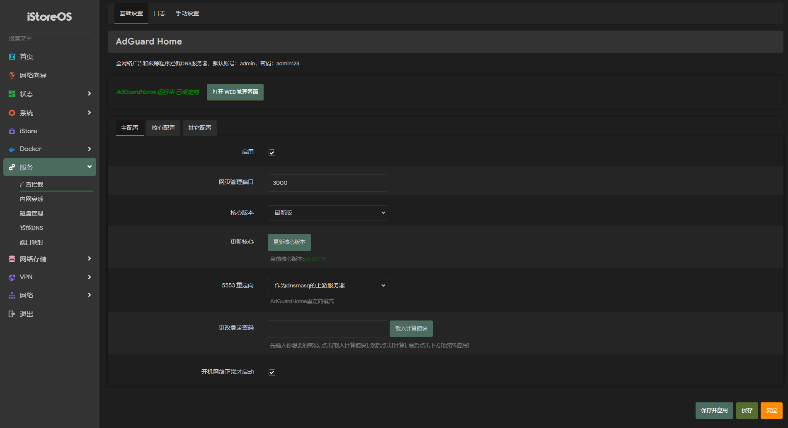

# 🛡️ luci-app-adguardhome

AdGuardHome 的 LuCI 管理界面。

AdGuardHome 是一个网络级广告拦截与隐私保护 DNS 服务器，能在全网络范围内屏蔽广告、跟踪器与恶意域名，并为上游 DNS 提供缓存。

LuCI 管理界面，不含 AdGuardHome 主程序，首次使用时需在线下载核心。

## ✨ 版本亮点

| 特性 | 说明 |
|------|------|
| **ipt / nft 自适应** | 按系统防火墙自动生成 DNS 重定向规则，iptables 与 nftables 环境通用 |
| **ipk / apk 自适应** | 同一源码同时产出 `.ipk` 与 `.apk`，按固件包管理器选用 |
| **架构通用** | 包体为 `all` 架构（纯 LuCI 界面，无编译二进制），arm / mips / x86 通用 |
| **翻译补全** | 简体中文词条补齐至 91/91 |
| **核心加速下载** | 除 GitHub 直连外增加两个镜像地址，镜像优先、直连兜底 |
| **若干 Bug 修复** | gfwlist 写入缩进错乱、核心更新注入、校验误删用户目录等 |
| **使用简易** | 自带配置，无需手动配置，安装后即可使用 |

## 📷 截图

## 📌 来源

基于 [rufengsuixing/luci-app-adguardhome](https://github.com/rufengsuixing/luci-app-adguardhome)（2019 年开源）整理。

## 📄 License

Apache-2.0，见 [LICENSE](LICENSE)。原始项目由 rufengsuixing 创建，修改声明见 [NOTICE](NOTICE)。